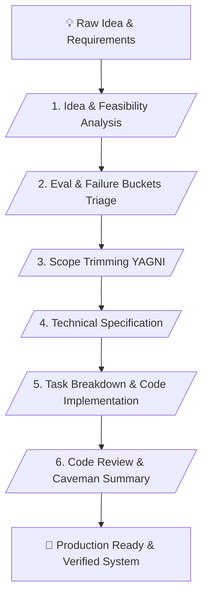

# ⚡ Dev-Pipeline Master Skill (v2.3 - Superpower Edition)

> **Structured AI Software Development, Embedded Systems Pipeline & Anti-Hallucination Framework**

---

## 📌 เหมาะกับการทำงานด้านใด? (Use Cases)

1. **Software & Embedded Systems Development** (การพัฒนาและควบคุมวงจรการสร้างโค้ดสำหรับไมโครคอนโทรลเลอร์ แพลตฟอร์มฮาร์ดแวร์ และซอฟต์แวร์ระบบ)
2. **System Failure Analysis & Triage** (การคัดกรอง จัดกลุ่มข้อผิดพลาด และสร้างชุดประเมินผลระบบก่อนลงมือแก้ไข)
3. **Scope Trimming & YAGNI Enforcement** (การควบคุมสโคปงานไม่ให้บานปลาย ตัดฟีเจอร์ส่วนเกินเพื่อให้ระบบส่งมอบได้รวดเร็ว)
4. **Rigorous Code Review & Architecture Audit** (การตรวจสอบความปลอดภัย ช่องโหว่ และโครงสร้างสเปกก่อนนำไปคอมไพล์)

---

## ⚙️ Workflow Overview (6 Stages)

