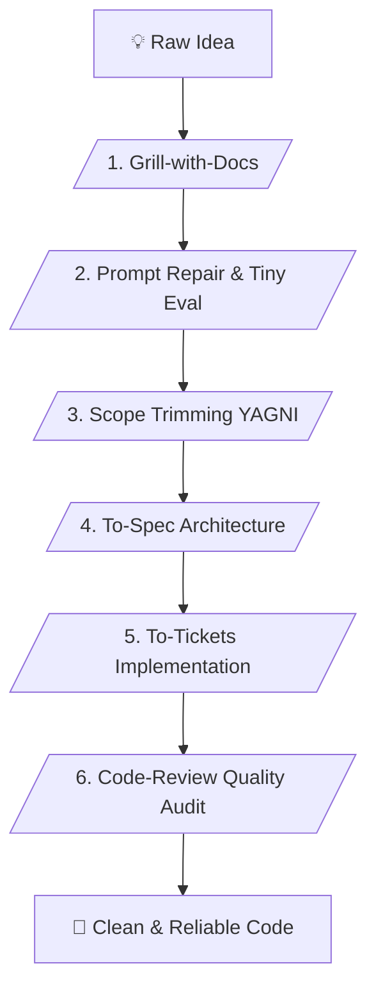

# ⚡ Matt Pocock Vibe Coding Master Skill (v1.3 - Superpower Edition)

> **Advanced AI Software Development Pipeline, Anti-Hallucination Playbook & Superpower Reliability Framework**

---

## 📌 เหมาะกับการทำงานด้านใด? (Use Cases)

1. **AI-First Development & Prompt Reliability** (การแก้ไขและซ่อมแซม Prompt ที่ทำงานได้ไม่สม่ำเสมอ ผ่านระบบ Tiny Eval และ Failure Buckets Triage)
2. **Software & Web/App Development** (การพัฒนา Frontend, Backend APIs, และ Full-Stack Web Applications อย่างเป็นระบบ)
3. **Indie Hacking & MVP Building** (การสร้างแอปพลิเคชันต้นแบบจากไอเดียอย่างรวดเร็วภายใต้สเปกและสโคปที่รัดกุมด้วยหลักการ YAGNI)
4. **Technical Product Managers & Agile Teams** (การแปลงความต้องการให้ออกมาเป็น Technical Spec, Data Contracts และ Task/Ticket ย่อย)

---

## ⚙️ Workflow Overview (6 Stages)

