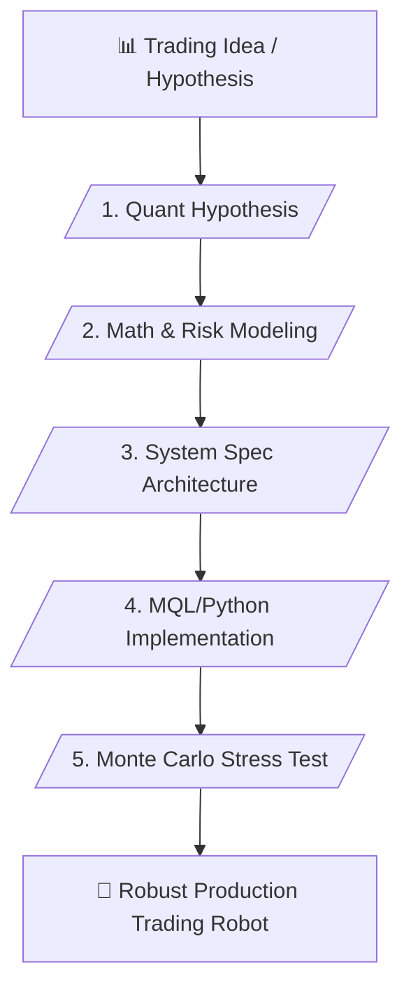

# 📈 Quant & Algorithmic Trading Architect Master Skill (v2.1 - Superpower Edition)

> **Quantitative Trading Strategy Design, Risk Modeling & Anti-Overfitting Stress Testing**

---

## 📌 เหมาะกับการทำงานด้านใด? (Use Cases)

1. **Algorithmic Trading & EA Development** (การออกแบบและเขียนระบบเทรดอัตโนมัติ MQL4/MQL5/Python)
2. **Mathematical Risk & Position Sizing** (การคำนวณการบริหารความเสี่ยงและขนาดออเดอร์ด้วยแบบจำลองทางสถิติ)
3. **Stress Testing & Anti-Overfitting** (การทดสอบความเสถียรด้วย Monte Carlo Simulation เพื่อป้องกัน Curve Fitting)
4. **Multi-Asset Strategy Design** (การออกแบบกลยุทธ์สำหรับหุ้น ฟอเร็กซ์ ทองคำ และคริปโทเคอร์เรนซี)

---

## ⚙️ Workflow Overview (5 Stages)

