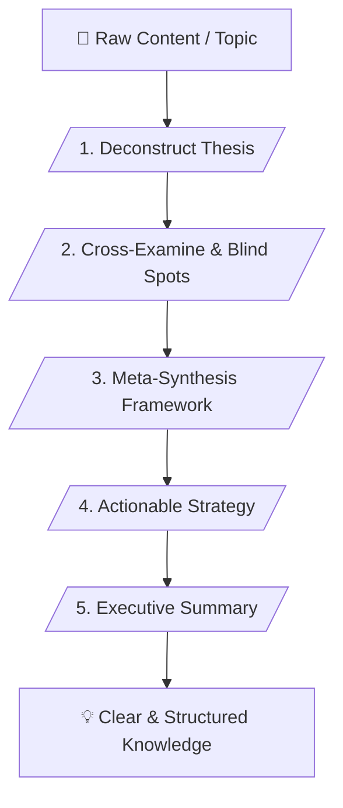

# 🧠 Universal Meta-Analyst Skill (v2.1 - Superpower Edition)

> **Universal Deep Analysis, Multi-Lens Verification & Anti-Hallucination Framework**

---

## 📌 เหมาะกับการทำงานด้านใด? (Use Cases)

1. **Cross-Disciplinary Content Deconstruction** (การแกะโครงสร้างและตีความข้อมูลทุกประเภทอย่างไร้ขีดจำกัด)
2. **Multi-Lens Critical Analysis & Blind Spot Hunting** (การวิเคราะห์ปัญหาผ่านหลากหลายมุมมอง)
3. **Knowledge Synthesis & Framework Creation** (การสังเคราะห์องค์ความรู้ให้เป็นเฟรมเวิร์กที่เข้าใจง่าย)
4. **Actionable Strategy Generation** (การแปลงข้อมูลเชิงซับซ้อนให้เป็นข้อเสนอแนะเชิงปฏิบัติ)

---

## ⚙️ Workflow Overview (5 Stages)

