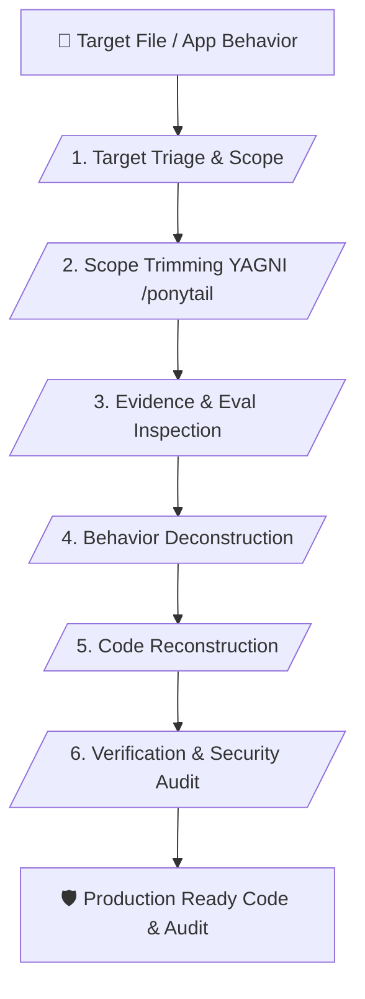

# 🔍 Reverse Engineering & Code Analysis Master Skill (v2.1 - Superpower Edition)

> **Advanced Agent-Oriented Reverse Engineering, Evidence-Based Inspection & Anti-Hallucination Framework**

---

## 📌 เหมาะกับการทำงานด้านใด? (Use Cases)

1. **Evidence-Based Binary & App Inspection** (การแกะรอยและวิเคราะห์ไฟล์ไบนารี/แอปพลิเคชันโดยอ้างอิงหลักฐานเชิงประจักษ์)
2. **YAGNI Scope Trimming & Deconstruction** (การคุมสโคปงานวิเคราะห์ ตัดการวิเคราะห์โค้ดส่วนเกินด้วย /ponytail)
3. **Pseudocode to Clean Implementation** (การถอดตรรกะจากภาพแอสเซมบลี/โค้ดจำลอง แล้วแปลงเป็น Clean Code)
4. **Security Audit & Triage Assessment** (การตรวจจับช่องโหว่ จัดกลุ่มความผิดพลาดตาม Triage Buckets)

---

## ⚙️ Workflow Overview (6 Stages)

