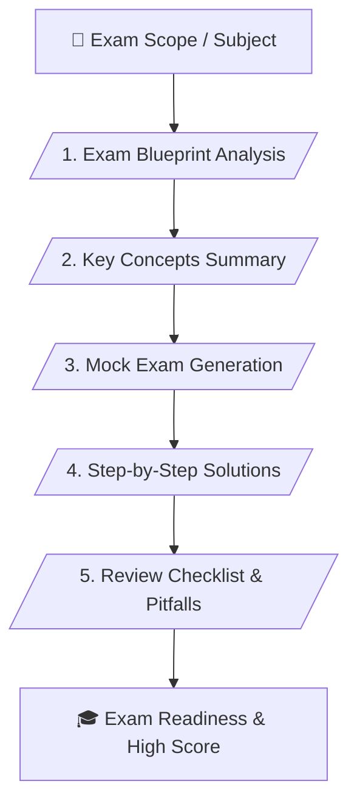

# 📚 Exam-Helper Master Skill (v1.1)

> **Academic Exam Blueprint Analysis, Practice Question Generation & Verified Solutions**

---

## 📌 เหมาะกับการทำงานด้านใด? (Use Cases)

1. **Exam Blueprint & Scope Analysis** (การวิเคราะห์โครงสร้างข้อสอบและขอบเขตเนื้อหาที่จะออกสอบ)
2. **Mock Test Generation** (การสร้างชุดข้อสอบจำลองพร้อมระดับความยากใกล้เคียงข้อสอบจริง)
3. **Step-by-Step Solutions & Explanations** (การทำเฉลยอย่างละเอียด อธิบายตัวเลือกที่ถูกและผิดอย่างเป็นระบบ)
4. **Common Pitfalls Review** (การสรุปจุดที่นักเรียนมักทำผิดพลาดบ่อยเพื่อป้องกันการเสียคะแนน)

---

## ⚙️ Workflow Overview (5 Stages)

