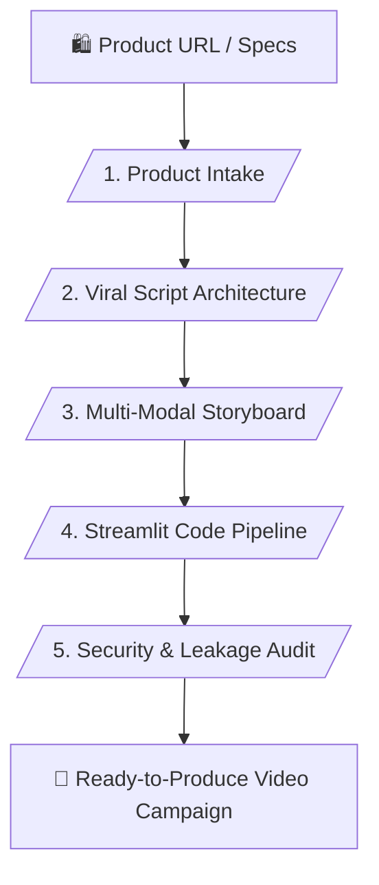

# 🎬 Autonomous Multi-Modal Affiliate Production Suite (v8.6.3.0)

> **Automated Affiliate Video Scripting, Verified Product Specs & Anti-Leakage System**

---

## 📌 เหมาะกับการทำงานด้านใด? (Use Cases)

1. **Affiliate Content Creation** (การสร้างสคริปต์วิดีโอและ Storyboard สำหรับทำคลิปป้ายยาโปรโมตสินค้า)
2. **Multi-Language AI Prompting** (การแปลงพรอมต์ภาพและเสียงสำหรับเครื่องมือ AI Video รองรับหลายภาษา)
3. **Streamlit App Integration** (การวางระบบแอปพลิเคชันรันโปรเซสสร้างคอนเทนต์อัตโนมัติ)
4. **Prompt Leakage Prevention** (การป้องกันและเพิ่มความปลอดภัยให้กับพรอมต์ระบบ)

---

## ⚙️ Workflow Overview (5 Stages)

