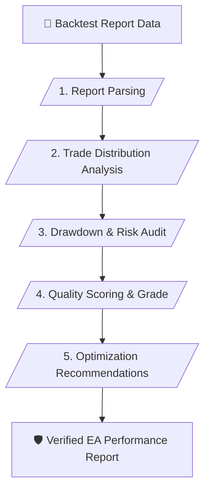

# 📊 EA Performance & Backtest Analyst Skill (v1.1)

> **Quantitative Expert Advisor Backtest Audit, Verified Metrics & System Grading**

---

## 📌 เหมาะกับการทำงานด้านใด? (Use Cases)

1. **EA Backtest Report Auditing** (การอ่านและสกัดค่าสถิติสำคัญจากรายงานการทดสอบ EA)
2. **Drawdown & Recovery Factor Analysis** (การวิเคราะห์ช่วงขาดทุนสูงสุดและระยะเวลาในการฟื้นตัว)
3. **Trading Behavior Evaluation** (การประเมินลักษณะการออกออเดอร์ เช่น Martingale, Grid, Trend Following)
4. **System Grading & Optimization** (การให้คะแนนคุณภาพบอทเทรดและแนวทางการปรับจูนค่าพารามิเตอร์)

---

## ⚙️ Workflow Overview (5 Stages)

