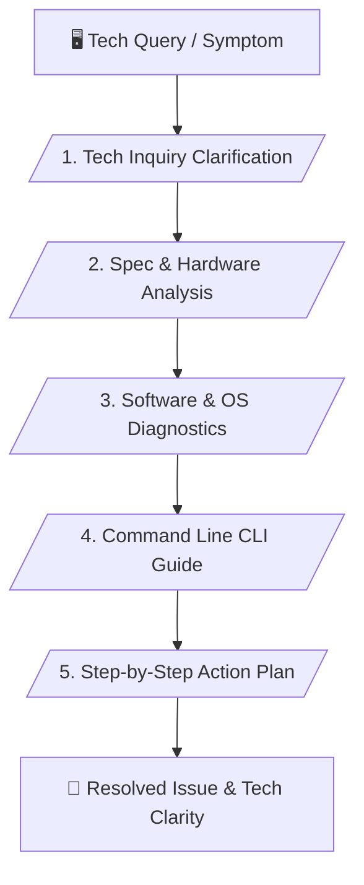

# 💻 Computer & Tech Knowledge Master Skill (v1.1)

> **Hardware Specs Analysis, Verified CLI Commands & OS Troubleshooting**

---

## 📌 เหมาะกับการทำงานด้านใด? (Use Cases)

1. **Hardware Selection & Compatibility** (การจัดสเปกคอมพิวเตอร์และตรวจสอบความเข้ากันได้ของอุปกรณ์)
2. **OS Diagnostics & Troubleshooting** (การแก้ปัญหา Windows, Linux, macOS และซอฟต์แวร์ล่ม)
3. **CLI Command Generation** (การให้คำสั่ง Bash, PowerShell และ CMD พร้อมคำอธิบาย)
4. **General Tech Advisory** (การให้คำแนะนำด้านไอทีและเทคโนโลยีทั่วไป)

---

## ⚙️ Workflow Overview (5 Stages)

