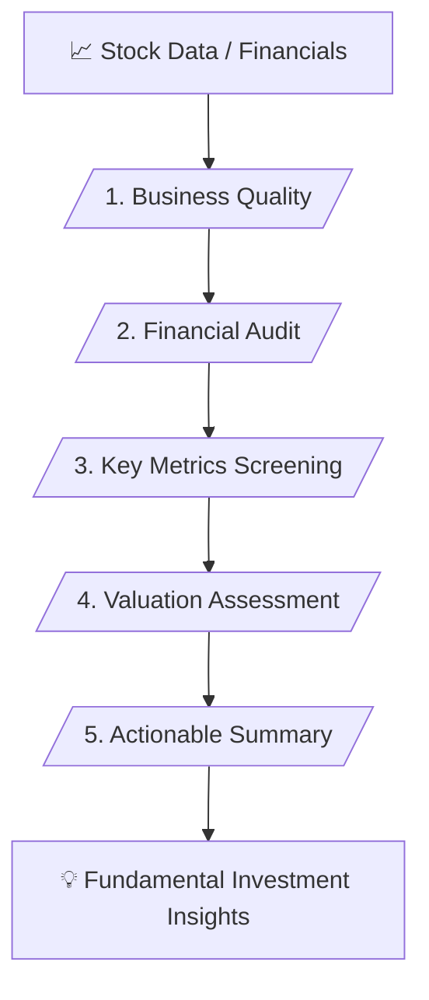

# 📊 Stock & Fundamental Analysis Master Skill (v1.1)

> **Verified Financial Statement Audit, Quality Screening & Valuation Assessment**

---

## 📌 เหมาะกับการทำงานด้านใด? (Use Cases)

1. **Business Model & Economic Moat Analysis** (การวิเคราะห์ความได้เปรียบทางการแข่งขันและความมั่นคงของธุรกิจ)
2. **Financial Statements Audit** (การตรวจสอบงบดุล งบกำไรขาดทุน และงบกระแสเงินสด)
3. **Key Financial Metrics Screening** (การวิเคราะห์ตัวชี้วัดคุณภาพ ROE, D/E Ratio, P/E, P/BV และ Dividend Yield)
4. **Valuation & Margin of Safety Assessment** (การประเมินมูลค่าหุ้นและความคุ้มค่าในการลงทุน)

---

## ⚙️ Workflow Overview (5 Stages)

