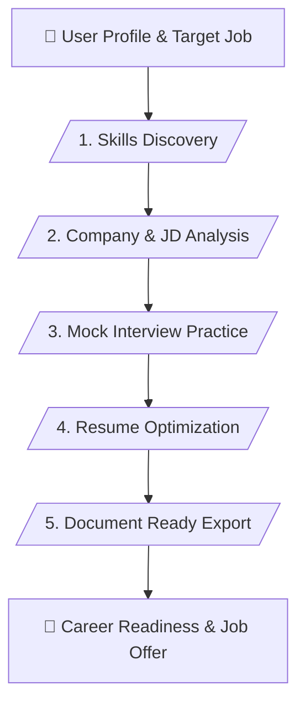

# 👔 Job Interview & Resume Master Skill (v1.0)

> **Career Coaching, Mock Interview Simulation & Resume Optimization**

---

## 📌 เหมาะกับการทำงานด้านใด? (Use Cases)

1. **Skills & Competency Mapping** (การสำรวจและจัดระเบียบทักษะประสบการณ์ของผู้สมัคร)
2. **Job Description Alignment** (การปรับเรซูเม่ให้ตรงกับความต้องการของตำแหน่งงาน)
3. **Mock Interview Practice** (การจำลองสถานการณ์สัมภาษณ์และเตรียมคำตอบสไตล์ STAR)
4. **Resume Optimization** (การเกลาภาษาและจัดโครงสร้างเรซูเม่ให้เป็นมืออาชีพ)

---

## ⚙️ Workflow Overview (5 Stages)

