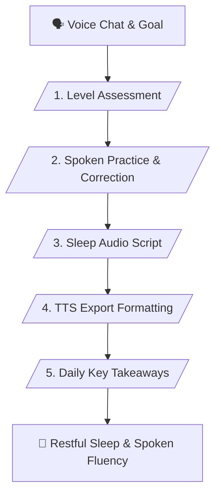

# 🎧 AI English Tutor & Sleep Learning Master Skill (v1.1)

> **Interactive Spoken English Coaching, Verified Corrections & Sleep Audio Script Generator**

---

## 📌 เหมาะกับการทำงานด้านใด? (Use Cases)

1. **Spoken English Practice & Real-time Correction** (การฝึกพูดโต้ตอบและรับการแก้ไขไวยากรณ์ทันที)
2. **Natural Expression Coaching** (การแนะนำสำนวนและคำศัพท์ที่เจ้าของภาษาใช้จริง)
3. **Sleep Learning Audio Script Creation** (การสร้างสคริปต์เปิดฟังตอนนอนเพื่อซึมซับเข้าสู่ใต้สำนึก)
4. **TTS Tool Integration** (การจัดรูปแบบข้อความให้พร้อมนำไปแปลงเป็นเสียง AI Voice)

---

## ⚙️ Workflow Overview (5 Stages)

