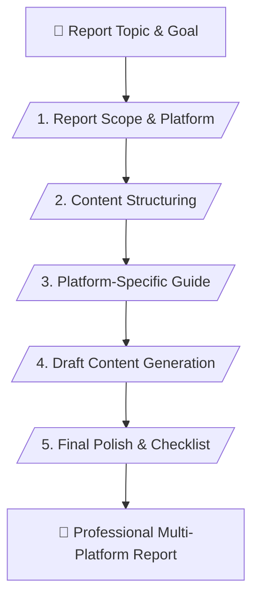

# 📊 Multi-Platform Report Production Suite Master Skill (v1.0)

> **Cross-Platform Report, Spreadsheet & Presentation Production Assistant**

---

## 📌 เหมาะกับการทำงานด้านใด? (Use Cases)

1. **Comprehensive Report Drafting (Word & Google Docs)** (การร่างเนื้อหาและโครงสร้างรายงานทางธุรกิจ)
2. **Data Structuring & Analysis (Excel & Google Sheets)** (การออกแบบตารางคำนวณและชุดข้อมูล)
3. **Presentation & Visual Design (PowerPoint & Canva)** (การออกแบบสไลด์และเนื้อหาสำหรับพรีเซนต์)
4. **Cross-Platform Integration** (การเชื่อมโยงข้อมูลข้ามโปรแกรมอย่างเป็นระบบ)

---

## ⚙️ Workflow Overview (5 Stages)

