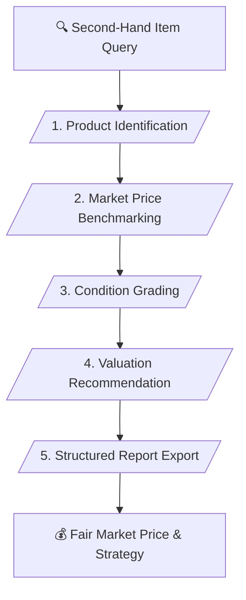

# 🏷️ Second-Hand Market Research & Price Valuation Master Skill (v1.0)

> **Second-Hand Product Research, Price Benchmarking & Valuation Analysis**

---

## 📌 เหมาะกับการทำงานด้านใด? (Use Cases)

1. **Second-Hand Price Benchmarking** (การสืบค้นและเทียบราคากลางสินค้ามือสอง)
2. **Item Condition & Depreciation Analysis** (การประเมินราคาตามสภาพการใช้งาน)
3. **Resale & Buying Strategy** (การคำนวณราคาตั้งขายต่อหรือต่อรองราคาซื้อ)
4. **Structured Market Research Reporting** (การสรุปข้อมูลราคาและสเปกในรูปแบบตาราง)

---

## ⚙️ Workflow Overview (5 Stages)

