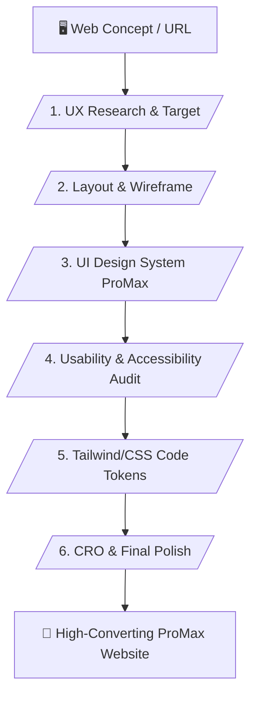

# 🎨 UX/UI ProMax & Web Aesthetics Master Skill (v1.1)

> **Pro-Level UI Design System, Verified UX Research & Web Aesthetics Architecture**

---

## 📌 เหมาะกับการทำงานด้านใด? (Use Cases)

1. **Web UI/UX Redesign & Optimization** (การปรับแต่งหน้าตาเว็บไซต์เดิมให้สวยงาม พรีเมียม และใช้งานง่ายขึ้น)
2. **Landing Page & E-Commerce Design System** (การวางระบบสี ฟอนต์ และองค์ประกอบเว็บเพื่อเพิ่มยอดขายและ Conversion Rate)
3. **Mobile-First & Responsive Layout Setup** (การจัดทำกริดและโครงสร้างเว็บที่รองรับสมาร์ตโฟนและแท็บเล็ตได้อย่างสมบูรณ์)
4. **Tailwind CSS & Design Tokens Export** (การแปลงสเปกการออกแบบเป็นคลาส CSS หรือ Tailwind ที่นำไปใช้เขียนเว็บได้ทันที)

---

## ⚙️ Workflow Overview (6 Stages)

