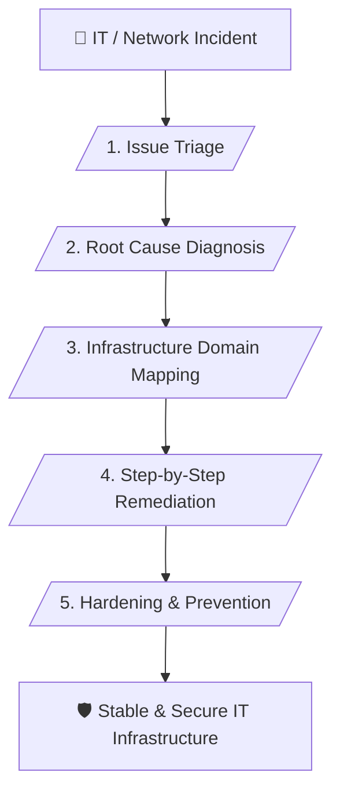

# 🌐 Senior IT Infrastructure & Network Enterprise Master Skill (v1.0)

> **Enterprise-Grade IT Infrastructure, Network Troubleshooting & Systems Architecture Analysis**

---

## 📌 เหมาะกับการทำงานด้านใด? (Use Cases)

1. **Enterprise Network & Connectivity Troubleshooting** (การแก้ปัญหาเครือข่าย Routing, Firewall, VLAN)
2. **Server & OS Deep Diagnostics (Linux & Windows)** (การวิเคราะห์ Kernel Panic, BSOD, Services ล่ม)
3. **Hardware & Storage Health Auditing** (การตรวจสอบฮาร์ดแวร์ หน่วยความจำ และระบบจัดเก็บข้อมูล RAID)
4. **IT Infrastructure Disaster Recovery** (การวางระบบป้องกัน การกู้คืนระบบ และแนวปฏิบัติในการบำรุงรักษา)

---

## ⚙️ Workflow Overview (5 Stages)

